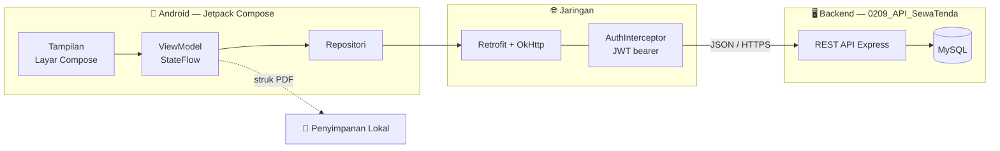
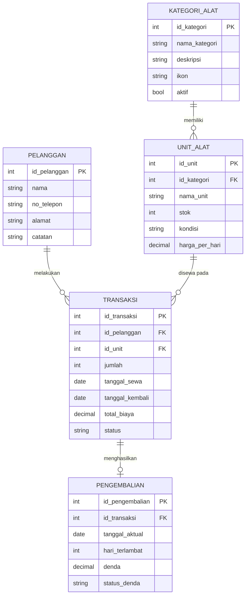

# 0209_SewaTenda

**Aplikasi Penyewaan Perlengkapan Pendakian Berbasis Android**

[](#)
[](#)
[](#)
[](#)
[](docs/SRS_SewaTenda_20240140209.pdf)
[](https://github.com/anzein-zayn/0209_API_SewaTenda)
[](#-log-progres-mingguan)

---

## 📖 Tentang Proyek

**SewaTenda** adalah aplikasi mobile untuk mengelola usaha penyewaan perlengkapan pendakian —
tenda, carrier, sleeping bag, matras, dan headlamp. Aplikasi ini digunakan oleh **pengelola (admin)**
untuk mencatat stok alat, data pelanggan, transaksi penyewaan, serta pengembalian beserta
**perhitungan denda keterlambatan secara otomatis**.

Proyek ini merupakan **Project Akhir mata kuliah Pengembangan Aplikasi Mobile (PAM) 2026**,
dibangun dengan **Jetpack Compose** dan arsitektur **MVVM**, terhubung ke **REST API** dengan
autentikasi **JWT** dan basis data **MySQL**.

| Keterangan | Isi |
|---|---|
| **Mata Kuliah** | Pengembangan Aplikasi Mobile (PAM) 2026 |
| **Jenis** | Tugas Akademik — Project Akhir |
| **Repositori Mobile** | [`0209_SewaTenda`](https://github.com/anzein-zayn/0209_SewaTenda) — aplikasi Android (4 digit NIM terakhir + nama project) |
| **Repositori API** | [`0209_API_SewaTenda`](https://github.com/anzein-zayn/0209_API_SewaTenda) — REST API backend (4 digit NIM terakhir + `API` + nama project) |
| **Dokumen SRS** | [`docs/SRS_SewaTenda_20240140209.pdf`](docs/SRS_SewaTenda_20240140209.pdf) — v1.6, 31 halaman, Appendix A–E |

> **Catatan:** proyek ini dipecah menjadi **dua repositori terpisah** sesuai pedoman —
> **Mobile** untuk aplikasi Android dan **API** untuk backend. Dokumen SRS, mockup, dan
> seluruh kode Android berada di repositori Mobile; kode backend dan skema basis data berada
> di repositori API.

---

## ✨ Fitur Utama

| No | Modul | Deskripsi | Status |
|----|-------|-----------|--------|
| 1 | **Autentikasi** | Login dan register admin, Access Token (JWT, 15 menit) + Refresh Token (7 hari) | ⏳ |
| 2 | **Dasbor** | Ringkasan stok, transaksi aktif, keterlambatan, dan total denda | ⏳ |
| 3 | **Kategori Alat** | CRUDS kategori (tenda, carrier, sleeping bag, matras, headlamp) | ⏳ |
| 4 | **Unit Alat & Stok** | CRUDS unit alat, kondisi alat, harga sewa per hari, stok berkurang otomatis | ⏳ |
| 5 | **Pelanggan** | CRUDS data pelanggan beserta riwayat penyewaan | ⏳ |
| 6 | **Transaksi Penyewaan** | CRUDS transaksi, perhitungan biaya otomatis, struk PDF | ⏳ |
| 7 | **Pengembalian & Denda** | CRUDS pengembalian, denda keterlambatan otomatis, status pembayaran denda | ⏳ |
| 8 | **Laporan** | Rekap transaksi dan pendapatan per periode | ⏳ |
| 9 | **Profil** | Profil admin, logout, informasi aplikasi | ⏳ |
| 10 | **Penyimpanan Berkas** | Menyimpan dan membaca struk PDF di penyimpanan lokal perangkat | ⏳ |

> **Keterangan status:** ✅ selesai · 🔄 sedang dikerjakan · ⏳ belum dimulai

### Cakupan CRUDS

Setiap modul data wajib memiliki kelima operasi **CRUDS** (Create, Read, Update, Delete, Search)
sesuai pedoman Bagian D butir 6.

| Modul | Create | Read | Update | Delete | Search |
|-------|--------|------|--------|--------|--------|
| Kategori Alat | ✅ | ✅ | ✅ | ✅ | ✅ |
| Unit Alat & Stok | ✅ | ✅ | ✅ | ✅ | ✅ |
| Pelanggan | ✅ | ✅ | ✅ | ✅ | ✅ |
| Transaksi Penyewaan | ✅ | ✅ | ✅ | ✅ | ✅ |
| Pengembalian & Denda | ✅ | ✅ | ✅ | ✅ | ✅ |

*(Tanda ✅ menandakan kebutuhan sudah **dispesifikasikan** pada SRS §3.1–3.5, **didokumentasikan**
pada activity diagram SRS B.5–B.9, dan **dirancang** pada mockup 17 layar. Implementasi kode
menyusul.)*

---

## 🏗️ Arsitektur

Aplikasi menggunakan pola **MVVM** dengan pemisahan lapisan yang jelas. Tidak ada penyimpanan
lokal terstruktur (Room dilarang sesuai pedoman); satu-satunya input/output berkas adalah
**struk PDF**.



### Alur Data

```
Antarmuka (Compose) → ViewModel (StateFlow<UiState>) → Repositori → Retrofit → REST API → MySQL
                          ↑                                                    │
                          └──────────── respons JSON ───────────────────────────┘
```

**Prinsip yang diterapkan:**

- **Satu sumber kebenaran** di `ViewModel` melalui `StateFlow` + `UiState`
  (Memuat / Berhasil / Gagal / Kosong)
- **Repositori** sebagai satu-satunya pintu akses data (tidak ada pemanggilan API dari lapisan UI)
- **AuthInterceptor** menyisipkan `Authorization: Bearer <access_token>` secara otomatis
- **Alur refresh token**: respons `401` → refresh → ulangi permintaan sekali → jika gagal, logout
- **Navigation Compose** untuk seluruh perpindahan layar (tanpa satu Activity per halaman)

---

## 🧰 Teknologi yang Digunakan

### Sisi Android

| Komponen | Teknologi |
|----------|-----------|
| Bahasa pemrograman | Kotlin |
| Antarmuka | Jetpack Compose + Material 3 |
| Navigasi | Navigation Compose |
| Manajemen status | ViewModel + StateFlow + Coroutines |
| Komunikasi jaringan | Retrofit 2 + OkHttp + Gson |
| Autentikasi | JWT (Access 15 menit, Refresh 7 hari) |
| Penyimpanan | Berkas lokal (struk PDF) — **tanpa Room** |
| Build | Gradle (Kotlin DSL) |

### Sisi Backend

| Komponen | Teknologi |
|----------|-----------|
| Runtime | Node.js + Express |
| Basis data | MySQL |
| Autentikasi | JWT (access + refresh token) |
| Format data | REST + JSON |

---

## 🗃️ Model Data

Lima entitas utama yang saling terhubung (rincian lengkap pada **SRS Appendix B** — ERD pada
B.2 dan activity diagram CRUDS pada B.5–B.9):



**Aturan bisnis penting:**

- Stok berkurang saat transaksi dibuat, dan bertambah saat alat dikembalikan
- Denda = `hari_terlambat × (harga_per_hari × 20%)`, dihitung otomatis saat pengembalian dicatat
- Kategori atau pelanggan yang masih terhubung dengan data aktif tidak dapat dihapus
  (validasi referensial)

---

## 🔌 Ringkasan REST API

Kontrak lengkap (contoh permintaan/respons, kode status, dan pemetaan requirement) tersedia pada
**SRS Appendix D**. Ringkasannya sebagai berikut.

| Grup | Endpoint | Keterangan |
|------|----------|------------|
| **Autentikasi** | `POST /api/auth/register`<br/>`POST /api/auth/login`<br/>`POST /api/auth/refresh`<br/>`POST /api/auth/logout` | Registrasi, login, perpanjang token, logout |
| **Kategori** | `GET/POST /api/kategori`<br/>`GET/PUT/DELETE /api/kategori/:id` | CRUDS kategori alat (`?search=` untuk pencarian) |
| **Unit Alat** | `GET/POST /api/unit-alat`<br/>`GET/PUT/DELETE /api/unit-alat/:id` | CRUDS unit dan stok (`?search=`, `?kategori=`) |
| **Pelanggan** | `GET/POST /api/pelanggan`<br/>`GET/PUT/DELETE /api/pelanggan/:id` | CRUDS pelanggan (`?search=`) |
| **Transaksi** | `GET/POST /api/transaksi`<br/>`GET/PUT/DELETE /api/transaksi/:id` | CRUDS transaksi (`?search=`, `?status=`) |
| **Pengembalian** | `GET/POST /api/pengembalian`<br/>`GET/PUT/DELETE /api/pengembalian/:id` | CRUDS pengembalian dan denda |
| **Dasbor** | `GET /api/dashboard` | Ringkasan statistik |
| **Laporan** | `GET /api/laporan?dari=&sampai=` | Rekap per periode |

**Konvensi:** seluruh endpoint (kecuali autentikasi) memerlukan header
`Authorization: Bearer <access_token>`. Respons berhasil menggunakan kode `2xx` dengan isi JSON
`{ "success": true, "data": ... }`, sedangkan kegagalan menggunakan kode `4xx`/`5xx` dengan isi
`{ "success": false, "message": "..." }`.

---

## 📁 Struktur Repositori

Proyek SewaTenda terdiri atas **dua repositori GitHub terpisah**:

| Repositori | Isi | Alamat |
|---|---|---|
| 📱 **Mobile** | Aplikasi Android (Jetpack Compose), dokumen SRS, dan mockup | [`0209_SewaTenda`](https://github.com/anzein-zayn/0209_SewaTenda) |
| 🖥️ **API** | REST API backend (Node.js + Express + MySQL) | [`0209_API_SewaTenda`](https://github.com/anzein-zayn/0209_API_SewaTenda) |

### 📱 Repositori Mobile — `0209_SewaTenda`

````
0209_SewaTenda/
├── README.md
├── docs/
│   ├── SRS_SewaTenda_20240140209.pdf    # Software Requirements Specification v1.6 (31 halaman)
│   ├── UI_Preview.png                   # Mockup layar 01–10
│   └── UI_Preview_CRUDS.png             # Mockup layar 11–17 (form dan dialog)
│
└── app/                                 # 📱 Aplikasi Android
    └── src/main/java/com/sewatenda/
        ├── data/
        │   ├── remote/                  # ApiService, AuthInterceptor, ApiClient
        │   ├── repository/              # Implementasi repositori per modul
        │   ├── model/                   # DTO permintaan dan respons
        │   └── local/                   # FileStorageHelper (struk PDF)
        ├── ui/
        │   ├── navigation/              # NavGraph, Routes
        │   ├── screens/                 # login, dasbor, kategori, unit, ...
        │   ├── components/              # AppBar, SearchBar, EmptyState, dll.
        │   └── theme/                   # Color, Type, Theme (hijau–coklat)
        ├── viewmodel/                   # ViewModel + UiState per modul
        └── util/                        # Formatter (Rupiah, tanggal), Session
````

### 🖥️ Repositori API — `0209_API_SewaTenda`

````
0209_API_SewaTenda/
├── README.md
├── src/
│   ├── routes/                          # auth, kategori, unit, pelanggan, ...
│   ├── controllers/                     # Logika tiap endpoint
│   ├── models/                          # Query MySQL
│   └── middlewares/                     # verifyToken, errorHandler
├── sql/
│   └── schema.sql                       # 5 tabel + relasi + data awal
├── .env.example                         # Contoh konfigurasi
└── package.json
````

---

## 🚀 Cara Menjalankan

### Prasyarat

- **Android Studio** Ladybug atau lebih baru (JDK 17)
- **Node.js** 18+ dan **MySQL** 8+
- Perangkat atau emulator Android dengan API 26+

### 1️⃣ Backend dan Basis Data

Backend berada di **repositori terpisah**:
[`0209_API_SewaTenda`](https://github.com/anzein-zayn/0209_API_SewaTenda)

```bash
# Mengambil repositori API
git clone https://github.com/anzein-zayn/0209_API_SewaTenda.git
cd 0209_API_SewaTenda

# Membuat basis data dan mengimpor skema
mysql -u root -p < sql/schema.sql

# Menyiapkan konfigurasi
cp .env.example .env        # sesuaikan DB_HOST, DB_USER, DB_PASS, JWT_SECRET

# Memasang dependensi dan menjalankan
npm install
npm run dev                 # default: http://localhost:3000
```

Uji cepat: `GET http://localhost:3000/api/health` → `{ "success": true }`

### 2️⃣ Aplikasi Android

1. Buka folder `app/` di Android Studio
2. Sesuaikan base URL pada `app/build.gradle.kts`:
   - Emulator → `http://10.0.2.2:3000/`
   - Perangkat fisik → `http://<IP-LAN-komputer>:3000/`
3. Lakukan sinkronisasi Gradle, lalu tekan **Run** ▶️
4. Login menggunakan akun awal dari `schema.sql`
   (default: `admin@sewatenda.id` / `admin123`)

---

## 📊 Progress Mingguan (Weekly Progress)

Berikut adalah linimasa pengembangan proyek **SewaTenda** yang direkonstruksi secara riil
berdasarkan riwayat `git commit` pada
[`0209_SewaTenda`](https://github.com/anzein-zayn/0209_SewaTenda) (Mobile) dan
[`0209_API_SewaTenda`](https://github.com/anzein-zayn/0209_API_SewaTenda) (API), mulai dari
**pertemuan 9 hingga pertemuan 16** sesuai pedoman Bagian C.

### 📅 Pertemuan 9 (17 – 23 Nov 2026) — `0209_SewaTenda`

- **Inisialisasi Repositori & Struktur Dokumen** (`b5de66b`, `1a0555e`, `73e318b`, `ac59927`, `eace811`): Initial commit, pembuatan dan penghapusan folder `docs/`, unggah berkas SRS PDF awal, serta penambahan struktur dasar proyek.
- **Penyusunan Deskripsi & Dokumen Proyek** (`e00d09c`, `c4354b8`, `2003bae`, `e0dbba7`): Penambahan deskripsi, daftar fitur, arsitektur, dan petunjuk instalasi; perbaikan penamaan berkas menjadi `SRS_SewaTenda_20240140209.pdf`.

### 📅 Pertemuan 10 (24 – 30 Nov 2026) — `0209_SewaTenda` + `0209_API_SewaTenda`

- **Mockup Antarmuka 17 Layar** (`a90b851`): Unggah hasil desain 10 layar utama dan 7 layar CRUDS/detail ke dalam `docs/` (`UI_Preview.png`, `UI_Preview_CRUDS.png`).
- **Revisi SRS ke v1.6** (`ac37436`): Pembaruan README dan dokumen SRS menjadi versi 1.6 — penambahan activity diagram CRUDS pada Appendix B.5–B.9 (31 halaman, 7 gambar).
- **Pemecahan Repositori** ⏳: Pemisahan kode menjadi **`0209_SewaTenda`** (Mobile: Android + dokumen) dan **`0209_API_SewaTenda`** (API: Express + MySQL), beserta penyesuaian README pada kedua repositori. *(hash commit menyusul setelah push)*

### 📅 Pertemuan 11 (1 – 7 Des 2026) — `0209_API_SewaTenda`

⏳ Belum dimulai — rencana: skema MySQL 5 tabel beserta data awal; autentikasi JWT (access + refresh
